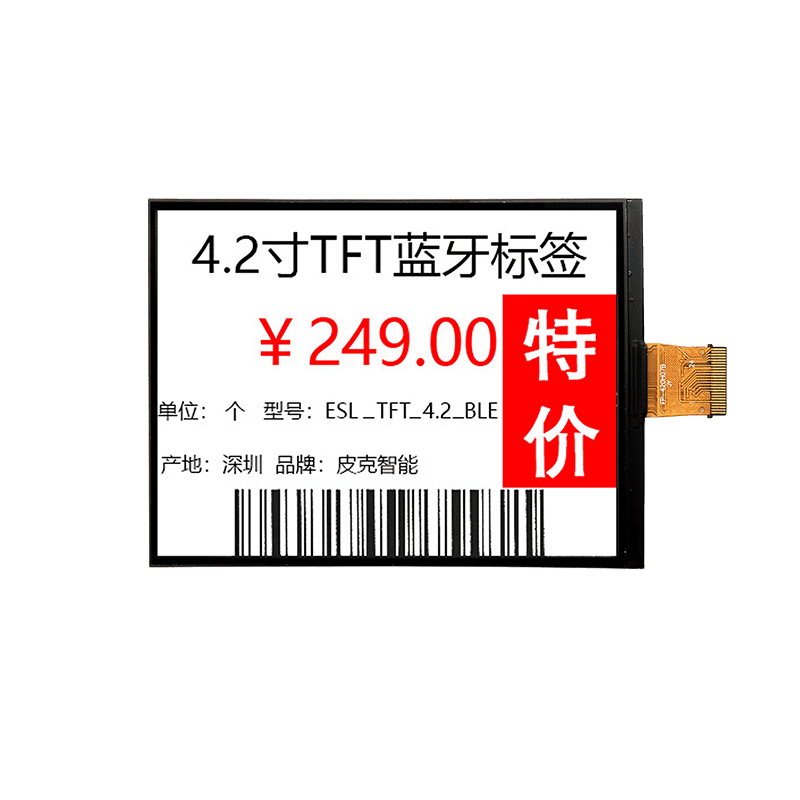

<p align="left"></p>

<h1 align="center">OSPTEK 4.2″ RLCD Display 300×400 (YDP420H003-V3)</h1>

<p align="center"><b>RLCD module · SPI · ST7306</b></p>

<p align="center"><a href="./README.md">简体中文</a> | English · <a href="../../README_EN.md">Family index</a></p>

<p align="center">
  
  
</p>

<p align="center"></p>

## Contents

- [Specifications](#specifications)
- [Resources](#resources)
- [Repository layout](#repository-layout)
- [Buy](#buy)
- [Support](#support)

---

## Specifications

| Item | Spec |
| ---- | ---- |
| Size | 4.2 inch |
| Type | RLCD |
| Resolution | 300×400 |
| Outline | 67.6 x 91.0 x 1.1 mm |
| Active area | 63.6 x 84.8 mm |
| Interface | SPI |
| Driver IC | ST7306 |
| Touch IC | — |

> Full outline, FPC definition, power, and timing follow the product datasheet / driver IC datasheet.

## Resources

| Category | File |
| ---- | ---- |
| Datasheet | [`HSD 4.2” 300x400 黑白红-转图说明 1.pdf`](./datasheets/HSD%204.2%E2%80%9D%20300x400%20%E9%BB%91%E7%99%BD%E7%BA%A2-%E8%BD%AC%E5%9B%BE%E8%AF%B4%E6%98%8E%201.pdf) |
| Datasheet | [`ST7306_V0.1.pdf`](./datasheets/ST7306_V0.1.pdf) |
| Datasheet | [`ST_7306_V0_1_c30c3541a3.pdf`](./datasheets/ST_7306_V0_1_c30c3541a3.pdf) |
| Datasheet | [`YDP420H003-V3.pdf`](./datasheets/YDP420H003-V3.pdf) |
| Datasheet | [`YDP_420_H003_V3_d136efd0a8.pdf`](./datasheets/YDP_420_H003_V3_d136efd0a8.pdf) |

## Repository layout

```text
display-rlcd-4.2inch-300x400/ # repo root (nav: ../../README_EN.md; sample projects under root examples/)
└── versions/
    └── YDP420H003-V3/        # full materials for this part number
        ├── README.md
        ├── README_EN.md
        ├── osptek.yml
        ├── images/
        └── datasheets/       # product datasheet + driver/touch IC datasheets
```

## Buy

See the [repo home page](../../README_EN.md#where-to-buy).

## Support

See the [repo home page](../../README_EN.md#support).

---

<p align="center"><sub>© 2026 OSPTEK · Materials in this repository are licensed under CC BY 4.0</sub></p>
