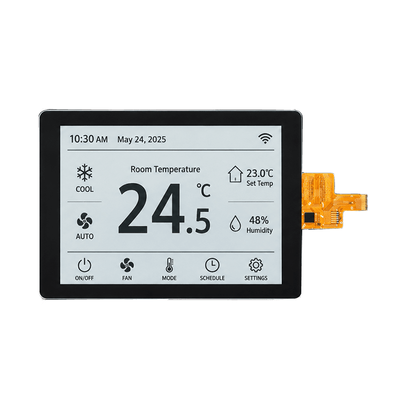

<p align="left"></p>

<h1 align="center">OSPTEK 4.2″ RLCD Display 300×400 (YDP420HT004-V3)</h1>

<p align="center"><b>RLCD module · SPI · ST7305</b></p>

<p align="center"><a href="./README.md">简体中文</a> | English · <a href="../../README_EN.md">Family index</a></p>

<p align="center">
  
  
  
</p>

<p align="center"></p>

## Contents

- [Specifications](#specifications)
- [Resources](#resources)
- [Repository layout](#repository-layout)
- [Buy](#buy)
- [Support](#support)

---

## Specifications

| Item | Spec |
| ---- | ---- |
| Size | 4.2 inch |
| Type | RLCD |
| Resolution | 300×400 |
| Outline | — |
| Active area | — |
| Interface | SPI |
| Driver IC | ST7305 |
| Touch IC | FT3269 |

> Full outline, FPC definition, power, and timing follow the product datasheet / driver IC datasheet.

## Resources

| Category | File |
| ---- | ---- |
| Datasheet | [`HSD 4.2” 300x400 Mono_转图说明.pdf`](./datasheets/HSD%204.2%E2%80%9D%20300x400%20Mono_%E8%BD%AC%E5%9B%BE%E8%AF%B4%E6%98%8E.pdf) |
| Datasheet | [`ST7305_V1.2.pdf`](./datasheets/ST7305_V1.2.pdf) |
| Datasheet | [`ST_7305_V0_2_d0b99d9cdb.pdf`](./datasheets/ST_7305_V0_2_d0b99d9cdb.pdf) |
| CAD file | [`YDP420H004-V3.dwg`](./cad/YDP420H004-V3.dwg) |
| CAD file | [`YDP420H004-V3_外形图.pdf`](./cad/YDP420H004-V3_%E5%A4%96%E5%BD%A2%E5%9B%BE.pdf) |
| CAD file | [`YDP420HT004-V3.dwg`](./cad/YDP420HT004-V3.dwg) |
| CAD file | [`YDP420HT004-V3_外形图.pdf`](./cad/YDP420HT004-V3_%E5%A4%96%E5%BD%A2%E5%9B%BE.pdf) |
| Adapter materials | [`SCH_2.9&4.2TP二合一转接板.pdf`](./adapter/SCH_2.9%264.2TP%E4%BA%8C%E5%90%88%E4%B8%80%E8%BD%AC%E6%8E%A5%E6%9D%BF.pdf) |

## Repository layout

```text
display-rlcd-4.2inch-300x400/ # repo root (nav: ../../README_EN.md; sample projects under root examples/)
└── versions/
    └── YDP420HT004-V3/        # full materials for this part number
        ├── README.md
        ├── README_EN.md
        ├── osptek.yml
        ├── images/
        ├── datasheets/       # product datasheet + driver/touch IC datasheets
        ├── cad/              # outline/cover CAD
        └── adapter/          # adapter board materials + photos
```

## Buy

See the [repo home page](../../README_EN.md#where-to-buy).

## Support

See the [repo home page](../../README_EN.md#support).

---

<p align="center"><sub>© 2026 OSPTEK · Materials in this repository are licensed under CC BY 4.0</sub></p>
